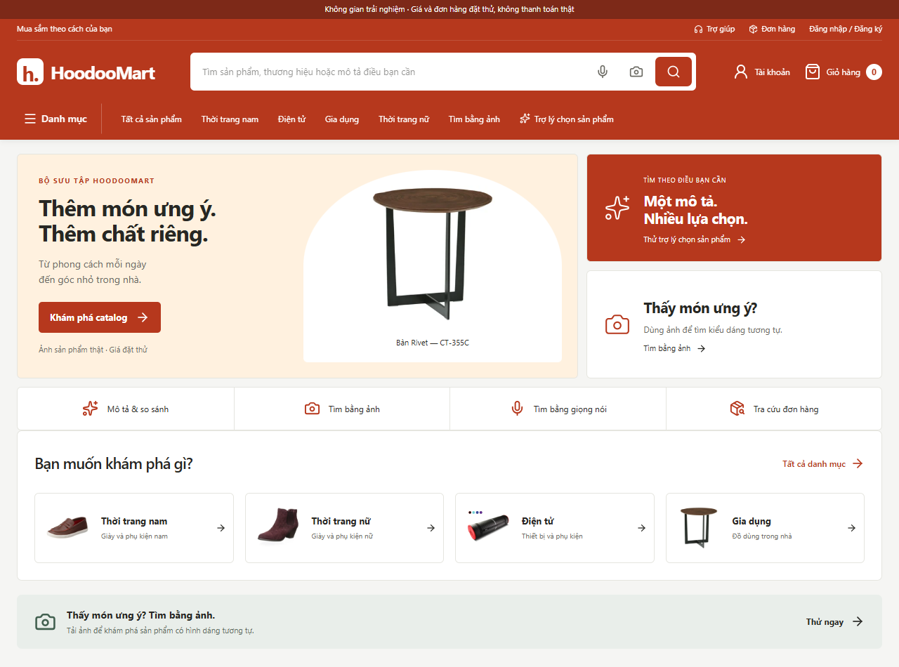

# Marketplace và AI — bàn giao 2026-10-23

## Đã triển khai

- Tham khảo cấu trúc trang chủ [Shopee](https://shopee.vn/) bằng Browser: utility bar/tìm kiếm/giỏ, banner chính và ô kề, lối tắt, danh mục, bộ sưu tập. Sau đọc cây nội dung gặp CAPTCHA; không vượt chặn, không nhận đã xem đầy đủ listing/PDP hay backend nội bộ Shopee. FE/BE ở đây là mã riêng của HoodooMart. Kế hoạch và token tại [MARKETPLACE_AI_PLAN](MARKETPLACE_AI_PLAN.md).
- Home gọn hơn, banner dùng sản phẩm thật, ảnh danh mục, Sheet danh mục có keyboard/focus, đường dẫn công cụ AI, tài khoản/role/đăng xuất theo phiên thật. Không tạo khuyến mại, đánh giá hoặc doanh số.
- `/assistant`: mô tả hình dáng → text tower của **OpenCLIP ViT-B/32 đang có** → vector512D cùng revision với gallery → cosine trong danh mục/giá/màu đã lọc. Không tải model mới, không API trả phí. Mapping Việt→khái niệm tiếng Anh hữu hạn; không LLM/chatbot tổng quát hay machine translation tự do.
- Giữ danh mục/ngân sách khi sửa câu; phân trang dùng snapshot điều kiện đã tìm. So sánh tối đa3 sản phẩm, truy vấn lại public catalog, hiển thị thuộc tính/nguồn/giá đặt thử, chỉ nói giá thấp nhất trong các lựa chọn. Không tự kết luận độ bền/chất lượng/hiệu năng hay tạo đơn.
- Image/Whisper tiếp tục suy luận thật, voice correction có lối sang tìm hình dáng. Không lưu hội thoại, raw ảnh/audio hoặc bản chép lời vào catalog.

Catalog hiện tại: **318 sản phẩm public, 624 ảnh được duyệt, 624 vector tương thích**, profile `real_demo`, LOCAL_ONLY=true. Không nhập thêm nguồn hoặc sửa ảnh/giá/kho/dữ liệu người dùng. Giấy phép ABO CC-BY-4.0 và attribution M8 giữ nguyên. Schema không đổi, head0005.

## Kiểm thử đã chạy

- Baseline:151 passed/72.02s (`../artifacts/marketplace-ai-baseline.txt`); DB test riêng do conftest bắt buộc hậu tố `_test`.
- Final: **175 passed/52.67s**, JUnit và log trong evidence/marketplace-ai. Bao gồm layer boundaries, rights, uploads, CSRF/IDOR/order/stock, mô tả không hiểu/order intent, bounded input, prefilter, so sánh/ẩn record và regression homograph/xếp hạng.
- Ruff/format, mypy39 source files, ESLint, TypeScript, Alembic check và build Docker đạt; logs tại evidence/marketplace-ai, build `artifacts/marketplace-ai-verified-build.log`, web cuối `artifacts/marketplace-ai-web-verified-build.log`.
- Chrome mới: **8 nhóm/55.011s**, home5 viewport360/390/768/1280/1440, Sheet/focus, AI thật, budget/context/page, compare, unknown recovery, keyword, mobile voice correction và đăng nhập/đăng xuất thật. Screenshot kiểm trực tiếp trong cùng thư mục. Voice correction được gõ, không gọi là ASR/TC2.
- Regression Chrome M8 chạy lại và ghi tách: **8 nhóm đạt**, gallery/zoom/cart/checkout/ownership/stock/cancel/voice/image/management cùng responsive. Không ghi đè evidence M8 cũ.
- ASR qua BFF trên1 VIVOS human clip VIVOSDEV05_155, 2.375s: HTTP 3720.502ms, WER=0.1429; chỉ kiểm adapter hoạt động, không phải TC2 hoặc benchmark chất lượng tiếng Việt đại diện. Corrupt image/audio422; Origin giả403; JSON text worker sai/field dư422, body>2048B413. Không tái phân phối audio/transcript private.

## Số đo mới

Lượt mô tả đầu thực tế API: 20449.52ms, có tải model từ đĩa; không gọi là cache OS lạnh. Model dùng chung cho ảnh/mô tả, semaphore một tác vụ CPU. Không cam kết mọi lần dưới1s.

16 câu tự soạn trong từ vựng hữu hạn; 14 lượt không cache và 2 cache-equivalent tách riêng. Qua BFF HTTP trên catalog318: **warm uncached p50=219.197ms, p95=377.895ms**. Top1 khớp nhóm nguồn=1.00; mean P@5=0.85. Đây là proxy theo category nguồn, không human judgments, không phép đo hiểu mọi mô tả tiếng Việt. Các câu cố ý không trùng tên category; bộ từ vựng vẫn hữu hạn. Giữ kết quả kém trong bảng, không bỏ mẫu.

| Câu | Nhóm của top5 | P@5 |
|---|---|---:|
| chỗ ngồi | Ghế, Ghế, Ghế, Ghế, Ghế | 1.00 |
| chỗ ngồi bọc vải | Ghế, Ghế, Ghế, Ghế, Bàn | 0.80 |
| chỗ ngồi tối giản | Ghế, Ghế, Ghế, Ghế, Ghế | 1.00 |
| đồ chiếu sáng | Đèn bàn, Đèn bàn, Đèn bàn, Đèn bàn, Đèn bàn | 1.00 |
| đồ chiếu sáng tối giản | Đèn bàn, Đèn bàn, Đèn bàn, Đèn bàn, Đèn bàn | 1.00 |
| đồ chiếu sáng màu trắng | Đèn bàn, Dụng cụ nhà bếp, Bộ sạc, Bộ sạc, Bộ sạc | 0.20 |
| đồ lót sàn | Thảm, Thảm, Thảm, Thảm, Thảm | 1.00 |
| đồ lót sàn mềm | Thảm, Thảm, Thảm, Thảm, Thảm | 1.00 |
| đồ lót sàn hình học | Thảm, Thảm, Thảm, Thảm, Thảm | 1.00 |
| đồ tựa đầu | Gối, Gối, Bộ sạc, Ghế sofa, Ghế sofa | 0.40 |
| đồ tựa đầu bọc vải | Gối, Gối, Gối, Gối, Ghế sofa | 0.80 |
| đồ tựa đầu tối giản | Gối, Ghế sofa, Gối, Bộ sạc, Ghế sofa | 0.40 |
| vỏ bảo vệ điện thoại | Ốp điện thoại, Ốp điện thoại, Ốp điện thoại, Ốp điện thoại, Ốp điện thoại | 1.00 |
| vỏ bảo vệ điện thoại tối giản | Ốp điện thoại, Ốp điện thoại, Ốp điện thoại, Ốp điện thoại, Ốp điện thoại | 1.00 |
| đồ mang chân | Giày nữ, Giày nữ, Giày nam, Giày nam, Giày nữ | 1.00 |
| đồ mang chân thể thao | Giày nữ, Giày nam, Giày nam, Giày nam, Giày nam | 1.00 |

Latency/quality M8 và benchmark3k mô phỏng M7 là lịch sử riêng, không dùng làm kết quả mới. Không đo field INP, peak RAM hay quy mô thật1000/3000 trong đợt này.

## Lỗi đã gặp và sửa

Từ “đồ” sau bỏ dấu bị hiểu thành màu đỏ. Đã loại homograph khi còn dấu và thêm kiểm tra vẫn giữ đỏ trong “đồ màu đỏ”; bản sửa đầu làm mất cả đỏ, regression bắt lỗi trước bàn giao. Xếp hạng mô tả trước đó gộp cosine gần nhau thành cùng band rồi ưu tiên ID: dùng độ chính xác cao hơn riêng nhánh mô tả. Không đổi band ảnh M8. `runtime-before-homograph-fix.json` giữ nguyên kết quả lỗi; nhãn qrels tên category cũng đã sửa đúng catalog, nên không dùng chênh lệch trước/sau làm thước đo cải tiến model.

Hai lỗi harness Chrome: alert trùng route announcer của Next, và chờ utility bar đang ẩn ở mobile. Đã scope alert và kiểm logout mobile qua trang tài khoản, desktop qua utility bar. Bổ sung nhãn tài khoản cho icon mobile. ESLint chạy root không có config; chạy lại đúng apps/web đạt. Log chi tiết cục bộ giữ trong artifacts, không nhận các lượt lỗi là đạt.

## Tệp thay đổi chính xác

- Backend: `apps/api/app/domain/media.py`; `application/search.py`, `application/query_parser.py`, `application/shopping_assistant.py` (mới); `infrastructure/media.py`; `core/dependencies.py`; `api/v1/assistant.py` (mới); `app/main.py`; `apps/inference/main.py`; `apps/api/tests/test_shopping_assistant.py` (mới).
- FE: `apps/web/src/app/page.tsx`, `layout.tsx`, `marketplace-ai.css` (mới), `assistant/page.tsx` (mới), `search/page.tsx`, `search/image/page.tsx`, `search/voice/page.tsx`; components `site-header.tsx`, `voice-search.tsx`, `category-menu.tsx`, `marketplace-banner.tsx`, `ai-navigation.tsx`, `shopping-assistant.tsx` (4 tệp sau mới); `src/lib/schema.ts`, `docs/openapi.json` sinh lại.
- Tools: `benchmarks/scripts/marketplace_ai_runtime.py`, `marketplace_ai_browser.py`, `marketplace_ai_regression.py`, `scripts/report_marketplace_ai.py` (mới).
- Docs: README, PROGRESS, IMPLEMENTATION_PLAN, API_CONTRACTS, ARCHITECTURE; hai tài liệu MARKETPLACE_AI; evidence/marketplace-ai mới. Không có Git trong workspace khi kiểm, nên đây là danh sách theo tệp sửa, không `git diff`. Báo cáo nghiệm thu M7/M8 giữ nguyên.

## Chạy và kiểm lại

Mở [HoodooMart](http://localhost:3000), [Trợ lý](http://localhost:3000/assistant), [API](http://localhost:8000/docs). Models/dataset đã có trên máy; khởi động không tải ngầm.

```powershell
docker compose --env-file .env -f infra/docker-compose.yml up -d --build --wait
.\.venv\Scripts\python.exe -m pytest apps/api/tests -q --junitxml=docs/evidence/marketplace-ai/pytest.xml
.\.venv\Scripts\python.exe benchmarks/scripts/marketplace_ai_runtime.py
.\.venv\Scripts\python.exe benchmarks/scripts/marketplace_ai_browser.py
.\.venv\Scripts\python.exe benchmarks/scripts/marketplace_ai_regression.py
```

TEST_DATABASE_URL phải là DB riêng hoodoomart_test. Chạy tuần tự sau build. Muốn đo mới tránh cache prompt, restart API rồi chờ health; worker có thể giữ model warm. Không dùng lượt cache-hit làm uncached latency. Tái tạo catalog/model theo README và RUNBOOK, phải có đồng ý trước weights mới.

## Giới hạn và việc còn lại

TC2 nguyên câu vẫn chờ file âm thanh thật của người dùng; chưa được gửi. Whisper base còn yếu; browser on-device thử nghiệm, không dùng cloud thay thế. Mô tả chỉ hỗ trợ từ vựng đã ghi; thuộc tính nguồn thiếu vẫn thiếu, ảnh có thể gồm nhiều vật thể làm lệch ranking. Không có LLM tư vấn kiến thức mở hoặc nhận diện chính xác SKU chỉ từ ảnh. Giá/kho/đơn thử mô phỏng, không thanh toán/giao hàng thật. Chưa mở rộng catalog thật1000/3000 hoặc đầy đủ34 leaf. Không gọi đây là bản production Shopee.


